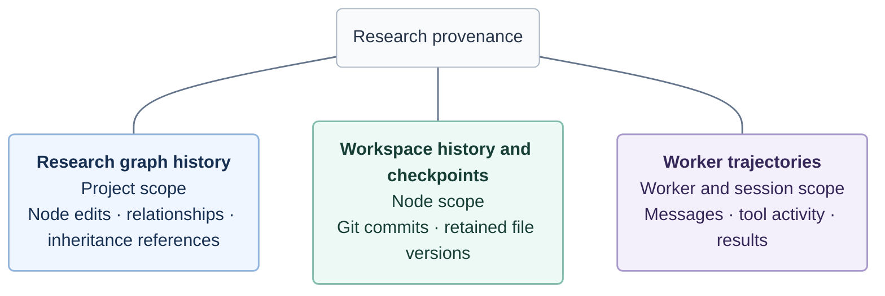

# Research provenance

## Three complementary records

Provenance helps you return to earlier work and understand how it developed.
Polariton preserves three complementary records: **research graph history**,
**workspace history and checkpoints**, and **worker trajectories**. Together they
provide evidence about the structure of an investigation, the files it produced,
and the activity of its workers.



The lines group the three records; they do not represent execution order or
synchronization. **There is no single synchronized snapshot across all three.**
A checkpoint does not automatically capture a matching graph revision or position
in every worker's history. Use their retained identities and contents to understand
how they relate; proximity in time alone does not establish causality.

## How the research structure evolved

The project's append-only graph history records node creation and edits, relationship
creation and edits, node archival, and relationship retractions. You can inspect how
the investigation grew and how its descriptions changed, rather than seeing only
the current graph.

When a node is created from a checkpoint, its source reference identifies the
original node and checkpoint. That file inheritance is distinct from a descriptive
relationship such as “extends” or “compares.” A relationship records the meaning
assigned by a researcher or worker; it does not prove a dependency or causal result.

Moving cards around the canvas changes presentation, not research graph history.
See [research project structure](research-projects.md) for the underlying model.

## What the workspace contained

Each node has its own Git repository. Workers on that node share its files, staging
area and Git history. A published checkpoint retains an exact commit together with
its publisher, publication time and optional note. Git provides the retained file
contents, differences and commit ancestry.

Manual Git commits belong to the same history but do not automatically become
Polariton checkpoints. Publishing an unchanged workspace registers the existing
commit. Retained checkpoint references preserve published commits even if the
branch is later rewritten.

A new node can inherit supported files from a selected checkpoint into an independent
repository. It retains the source reference, but does not copy the original Git
history, workers or conversations. See [checkpoint use and limits](checkpoints.md)
for publication and inheritance details.

## What workers did and which tools they had

DeepSeek Harness retains each worker's session history, including messages, tool
activity and recorded results. Polariton presents these records in conversation and
trajectory views. Reading saved history does not activate the worker or make a model
request. Workers sharing a workspace still have separate conversations.

Worker records also retain their original creation settings and assigned environment
revision. Environment and capability records provide further context about selected
tool versions; managed releases retain build provenance. These records help identify
the tools available to a worker, while trajectories show their recorded use. An
assigned tool was not necessarily called, and a saved revision does not freeze an
external service or changing host installation. See [capabilities and environments](tools.md).

## Revisit a result

For a qubit-readout comparison, start with the node containing the result:

1. Inspect its relationships and graph history to understand how the comparison
   direction developed. Check any source checkpoint reference.
2. Find the relevant published checkpoint and inspect the committed data, analysis
   code and report. Current workspace files may have changed since publication.
3. Review the contributing workers' conversations and trajectories, alongside their
   assigned environment revisions. Follow the recorded tool inputs and results to
   assess the evidence for the comparison.

For command-line inspection, discover the relevant reads without starting execution:

```sh
npm run harnessctl -- graph history --help
npm run harnessctl -- checkpoint get --help
npm run harnessctl -- worker history --help
```

Follow returned history pagination; one page is not necessarily the complete record.
The [CLI guide](../reference/cli.md) explains progressive inspection.

These records support review, not automatic scientific certification. A checkpoint
may include unfinished shared edits and is not an atomic workspace backup. Its
publisher is not necessarily the author of every file; Polariton does not maintain
per-file worker attribution. Retained history and tool revisions do not guarantee
deterministic replay or capture every external effect. Preserve the underlying data
and workspaces using the [backup guidance](storage.md#back-up-safely).
