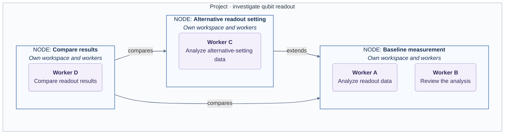

# Research project structure

## A project is a research graph

A project brings together a research objective, the work exploring it, and the
relationships between those pieces of work. Break a broad investigation into
focused questions, tasks, experiments or directions, represented by **nodes**.
A node is a persistent place to work: it can span many messages and executions,
rather than ending when one task finishes.

Polariton initializes a new project with a main node and an initial worker. Start
there and add nodes as useful distinctions emerge; you do not need to plan the
whole graph in advance.

For example, a quantum computing experiment investigating qubit readout might
contain a baseline measurement, an alternative readout setting, and a comparison
of their results:

The labeled arrows describe research relationships, not execution order or automatic
data flow. The two workers inside the baseline node share its files; each has its
own conversation. Their task labels are examples, not built-in worker roles.

## Nodes hold the work

Each node has a title, description and independent Git workspace. Its files can
include code, notes, data and results. This gives a research direction room to
develop without changing another node's files as a side effect.

For example, the alternative-setting node can hold a different readout configuration
and its measurement data while the baseline node keeps its reference data and
analysis. Nodes are separate repositories, not branches of one shared repository. A node's position on the graph does not determine its
filesystem nesting or access permissions.

## Workers act within nodes

A node can have multiple workers running concurrently. Workers on that node share
its files but keep separate conversations, execution context and permissions.
One worker might analyze the readout data while another reviews the analysis. They can see
each other's file changes, but do not automatically share conversation context.

Choose another worker when you want a separate approach within the same workspace.
Choose another node when the work needs separate files and Git history. Shared-file
edits still need coordination; adding workers does not automatically divide up tasks
or prevent conflicting changes.

## Relationships express meaning

Connect nodes with labels that explain your research, such as “extends,” “tests,”
or “compares.” A relationship also has room for an explanation. These labels are
chosen by the researcher; Polariton does not enforce a scientific taxonomy.

A node can connect to several others, and cycles are allowed. The project is a
graph rather than a strict parent–child task tree. Creating a relationship does not
start a worker, schedule a dependent task, copy files or transfer conversation
context. In the example, bringing results into the comparison workspace is an
explicit action, not an effect of drawing the arrows.

## Checkpoints let work branch

A checkpoint retains a committed state of a node's files. To explore an alternative,
you can create a new node from a selected checkpoint of an existing node. It receives
the supported files from that checkpoint in an independent repository, without the
source Git history, workers or conversations. Later changes do not synchronize
between the nodes.

A research relationship and checkpoint inheritance are separate choices: connecting
two nodes alone does not make one inherit the other's files. Checkpoints may include
unfinished shared edits, so review what you are saving. See
[checkpoint use and limits](checkpoints.md) for details.

**Rule of thumb:** create a node for a separate workspace, add a worker for another
conversation within that workspace, and add a relationship to explain how the work
connects. Follow [getting started](../start/getting-started.md) to put this model into practice.
