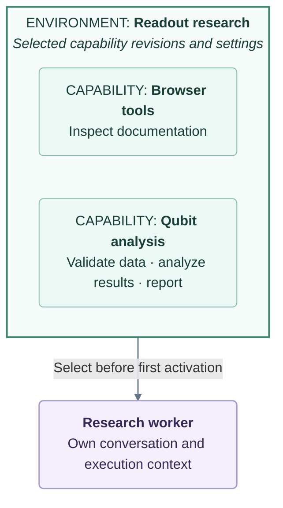

# Capabilities and environments

## A configured rack for a worker

Think of a research lab's instruments: each provides an ability, and a particular
experiment needs a selected set of instruments configured for the task.

- A **capability** is an instrument: a specific ability that may expose several MCP
  tools. A custom qubit-analysis capability might validate measurement data, analyze
  readout results and generate a report.
- An **environment** is a configured rack: a selection of capabilities, their exact
  revisions and settings, assembled for a kind of work.
- A **worker** uses the selected rack alongside its built-in Harness tools. Select
  one environment before its first activation; the assignment stays fixed afterward.
  A worker can also operate with **No environment**.



The capabilities shown are examples, not preinstalled tools. The rack is a
configuration metaphor, not a single container or a guarantee of exclusive tool
access. Capabilities may use local processes, managed containers or remote services.
EnvironmentDaemon manages many environments; the [architecture guide](../reference/architecture.md#capability-runtimes)
explains their runtime boundaries.

This design lets a lab improve its tooling as research progresses: turn a recurring
need into a tested capability, then reuse it in later work. A one-off analysis may
only need a script. New capability revisions do not silently change existing worker
assignments; adopting a different environment requires a new worker.

## Ask a worker to prepare what you need

**The recommended way to add or build a capability and prepare an environment is
to ask a Polariton worker.** Describe the research outcome; the worker can connect
existing tools or build custom lab tools using the bundled `make-polariton-tool`
guidance. Routine configuration need not be done manually.

### Add an existing tool

> Add [Playwright MCP](https://github.com/microsoft/playwright-mcp) as a Polariton
> capability, prepare an environment with it, and create a new worker using that
> environment to test opening a public documentation page.

### Build a custom lab tool

> Build a reusable capability for our qubit readout analysis. Inspect the example CSV
> files in this workspace, then implement an MCP tool that accepts measurement data
> and returns a comparison summary. Test with synthetic data and invalid inputs.
> Commit the package, prepare an environment containing it, and validate an actual
> tool call. Report the tests, remaining setup, and revision for a new worker.

The managed authoring path is **author and test → commit → prepare → validate**.
It uses a package in the current workspace; no separate repository or registry
publication is required. See [custom tool authoring](../reference/environments.md#custom-tool-authoring)
for container requirements and input boundaries.

Ask for an environment when you want a prepared combination for worker use. Adding
and completing a standalone capability alone does not create an environment.

## Use the prepared environment

1. Review the worker's readiness report and exact environment revision.
2. Complete required login and consent in **Environment → Capabilities**, or resolve
   reported host prerequisites. Keep credentials out of the conversation.
3. Ask the worker to continue the retained preparation operation and recheck affected
   components after setup is resolved.
4. Select the prepared revision for a new worker, or a worker that has never been
   activated, before sending its first message.

Preparation does not automatically create a worker or assign the new environment
to the worker doing setup. Restarting or resuming an activated worker does not unlock
its assignment, including **No environment**. Sending ordinary work never installs
packages or starts managed infrastructure; preparation is an explicit task.

## Understand readiness

| Evidence | What it establishes |
| --- | --- |
| Preparation | Required dependencies and infrastructure were prepared |
| Connection and discovery | Harness connected and discovered the server's tools |
| Functional check | A declared test operation produced an inspected outcome |

Validation connects and discovers tools through Harness without creating a worker
or making a model call. `--check NAME` runs an explicitly declared functional check
with its declared effects and budget. Preparation is not connection evidence;
discovery is not a functional pass; a functional pass is not continuous health.

A saved capability or environment definition alone does not establish readiness.
Preparation may be partial or blocked; inspect each component. None of these checks
guarantees continuous availability or scientific correctness. Review methods and
results before relying on a custom tool in research.

## Supported capability sources

Workers can prepare capabilities from the following sources within the supported
runtime and prerequisite contracts:

| Source | Supported preparation contract |
| --- | --- |
| npm / PyPI | Exact packages with private reusable installations; npm hooks disabled, PyPI wheels only |
| NuGet / Cargo | Explicit package versions and required SDK/compiler; Cargo needs native-build authority |
| OCI image | Exact image selection; isolated prepared stdio instances, without network, host mounts, credential injection or persistent volumes |
| MCP bundle | Integrity-checked MCPB manifest 0.3 with direct Node/Python/native entrypoints |
| Git package | Exact committed subtree and declared build/test recipe |
| Existing installation | Explicit executable and declared prerequisites; host drift requires revalidation |
| HTTP MCP endpoint | External service reference; Polariton does not operate the remote service |

Convenience prefixes are `npm:`, `pypi:`, `nuget:`, `cargo:` and `oci:`; HTTP URLs
select external endpoints. Exact package versions are required. Bundles, installed
commands, Git packages and mixed environments use `--input specification.json`.
Use `environment prepare --help --schema --json` for the complete contract. Updating an
existing environment requires its target ID, expected revision and complete component
list; a stale revision conflicts rather than overwriting concurrent changes.

See the [preparation reference](../reference/environments.md#prepare-and-validate-tools)
for the complete CLI workflow and [compatibility](../reference/compatibility.md) for verification
scope.

## Technical reference

For direct CLI use, begin with discovery:

```sh
npm run harnessctl -- environment prepare --help
npm run harnessctl -- environment prepare --help --schema --json
```

The [capability and environment reference](../reference/environments.md) preserves the
full procedures:

- [Preparation and validation procedures](../reference/environments.md#prepare-and-validate-tools)
- [Account setup](../reference/environments.md#capability-pages-and-accounts)
- [Blocked operations and recovery](../reference/environments.md#recover-a-blocked-operation)
- [Expert registration and composition](../reference/environments.md#expert-registration-and-composition)
- [Custom tool authoring](../reference/environments.md#custom-tool-authoring)
- [Managed container setup](../reference/environments.md#managed-containers)
- [Inspection and troubleshooting](../reference/environments.md#inspect-and-troubleshoot)
