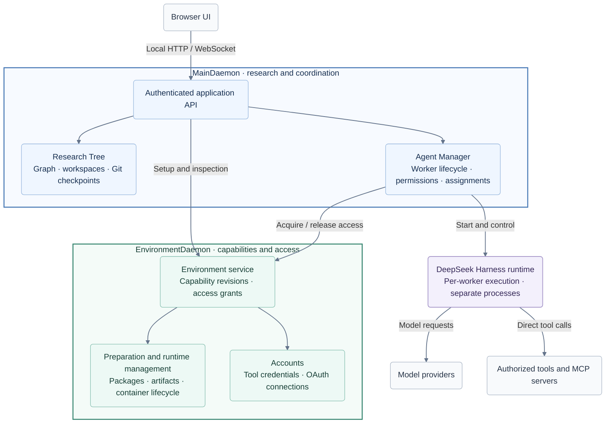
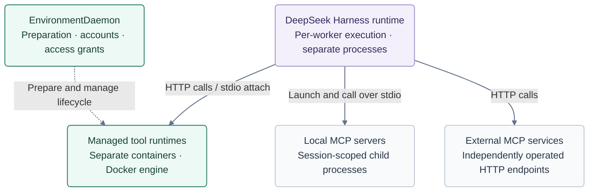

# Architecture

Polariton is a local application built around two peer daemon processes:
**MainDaemon** owns research and worker coordination; **EnvironmentDaemon** owns
capability preparation and access. Research Tree and Agent Manager are modules
inside MainDaemon, not separate services.

The separation lets research coordination and tool infrastructure have their own
state and lifecycles. Preparing a tool is an explicit operation; sending a research
task uses the tools already prepared for that worker.

`npm start` launches both daemons and opens the browser. The source checkout contains
application code; persistent user data lives in [OS data directories](../guides/storage.md).

The colored containers mark the two daemon boundaries; their inner boxes summarize
responsibilities rather than every implementation class. Main communicates with
Environment over an authenticated local Unix socket. The browser reaches Environment
through Main's API.

The DeepSeek Harness runtime executes per worker outside both daemons and calls
models and tools directly. Tool runtimes also execute outside EnvironmentDaemon;
it prepares infrastructure and supplies access. The [capability runtime diagram](#capability-runtimes)
below distinguishes who launches and manages each kind of tool.

## Ownership

| Component | Owns |
| --- | --- |
| MainDaemon | Local browser/API authentication and application composition |
| Research Tree | Graph records, independent node workspaces, Git checkpoints |
| Agent Manager | Worker identity, admission, lifecycle, permissions, environment assignments |
| EnvironmentDaemon | Capability definitions, immutable revisions, preparation, credentials, access grants |
| DeepSeek Harness runtime | Model execution, tools, context, compaction, session history |
| Browser | Presentation, navigation, and graph layout |

Main and Environment each own their persistent records and recovery logic. An
Environment outage does not remove research projects, and workers with no assigned
environment can converse without that service. Activating a worker with an assigned
environment requires Environment to resolve access.

Separate daemon lifecycles do not guarantee uninterrupted work across restarts.
If execution or a tool operation has an uncertain outcome, inspect its status and
saved history before resuming. The normal launcher starts and stops both daemons
together; this shared launch does not make Environment part of Main's process.

## Research and workers

A project organizes research as a graph of nodes and relationships. Each node has
an independent Git workspace for its files. Relationships express how research
ideas connect; they do not schedule tasks or automatically coordinate agents.

Workers perform tasks within a node. Multiple workers can share the same node's
files while keeping separate conversations, execution context and permissions.
Use another worker to approach the same files with a separate conversation; use
another node when a research direction needs its own workspace. Shared files mean
workers can affect one another's work, so conflicting edits still need coordination.
The first worker is not a privileged supervisor of the others.

Research Tree owns the graph, workspaces and checkpoints. Agent Manager owns worker
identity and lifecycle, including whether a worker can start or resume work. This
separation allows research structure to remain available even when a worker is idle
or its runtime has stopped.

A checkpoint retains a commit in a node's shared Git history. It can be used to
start a new node with the selected files in an independent repository, without
copying the original workers or their conversation context. Publication stages the
whole workspace and may include unfinished edits from other workers; it is not an
atomic backup or a claim of exclusive authorship. Checkpoint publication and managed
uploads coordinate with each other without freezing ordinary worker edits. See
[checkpoint use and limits](../guides/checkpoints.md) for staging rules,
inheritance limits and recovery after an uncertain publication.

## Execution and history

The Harness adapter uses ACP for session setup and configuration, alongside a
Polariton-specific bridge for message delivery, execution observations and runtime
coordination.

When you send a message to a worker:

1. Main receives the request through its authenticated API and routes it to Agent
   Manager for the selected worker.
2. Agent Manager checks whether the work can be admitted. When activating a worker,
   it resolves access to the selected environment, if any, and starts the worker's
   DeepSeek Harness runtime through the Harness integration.
3. The runtime handles model requests, authorized tools and conversation context.
   Polariton does not implement a second model execution loop.
4. Main forwards live activity to the browser. Conversation and trajectory views
   also read the execution history retained by Harness.

Harness is the sole writer of execution history. Reading saved history does not
activate an agent or make a model request. Live updates show work as it happens;
retained history provides the records available for later inspection.

A research node, a Polariton worker, a Harness session and an operating-system
process are different identities. A worker's saved conversation is not tied to the
continued existence of one process, and workers sharing files do not share a single
conversation. Process failure can leave work uncertain; retaining history does not
make it safe to replay a task automatically.

## Capabilities

A **capability** describes a tool's source, how it runs, how to connect to it, and
what access or authentication it requires. An **environment** selects exact
capability revisions and settings for a worker. Ordinary conversation and built-in
Harness tools do not require a managed container environment.

Environment owns tool preparation, prepared artifacts, account connections and
access grants. Prepare tools explicitly, inspect their readiness, then select the
environment before a worker's first message. Once activated, the worker retains its
assignment; editing a capability does not silently change existing workers.
Sending or resuming work never installs packages or starts managed infrastructure.

Preparation can publish an environment revision while some components remain
blocked. A saved definition is therefore not proof that its tools are ready.
Blocked operations retain their progress and required actions so that setup can
continue through the original operation instead of repeating an uncertain install.

Harness connects to the authorized tools directly. For OAuth connections, it can
obtain current credentials through an access-scoped handle supplied by Environment;
Main does not become the store for those tool-account tokens.

Preparation, connection discovery and functional checks answer different questions:
are the dependencies prepared, can the server expose its tools, and does a declared
test operation work? None alone guarantees future availability. See
[capability operations](../guides/tools.md) for setup, validation and recovery.

### Capability runtimes

Tool execution has three distinct lifecycle boundaries:

- **Local MCP servers:** Harness launches session-scoped stdio child processes.
  Environment prepares package installations and resolves access before execution.
- **Managed tool runtimes:** Environment manages separate containers through Docker;
  tool code does not run inside the EnvironmentDaemon process. Authored managed
  servers expose HTTP connections. Generic OCI tools use containers started during
  explicit preparation; Harness launches `docker attach` to connect over stdio.
  Acquiring access does not start a new container.
- **External MCP services:** Harness connects to independently operated HTTP
  endpoints. Environment owns their configuration and account access, not the
  remote service lifecycle.

The dashed arrow represents infrastructure lifecycle management; the labeled Harness
arrows represent runtime connections. Environment supplies scoped access but is not
a proxy for tool calls. These runtime boxes describe deployment arrangements, not
an additional shared tool daemon. Storage, built-in Harness tools and temporary
build or validation processes are omitted to keep the runtime diagram focused.

## Contributor boundaries

The `harness/` integration isolates the application from Harness protocol and
storage details. Application modules use its public contracts instead of parsing
upstream session files or implementing another execution loop. This keeps Harness
responsible for model execution and history, and avoids competing sources of truth.

Browser code uses the adapted Harness presentation through `presentation.ts` and
`views.tsx`. Keeping presentation separate from runtime integration lets the UI
render conversations without taking ownership of execution or persistence. Build
checks enforce these import boundaries and verify the adapted code's provenance.

Each module should remain authoritative for the records it owns. Use typed contracts
across boundaries, bound resource use, and make failures observable. Operations that
may be retried need stable identities so recovery can inspect the original outcome
rather than accidentally repeat an effect. Follow [development](https://github.com/Dounan662/polariton-agent-space/blob/main/docs/DEVELOPMENT.md)
when changing these contracts.
